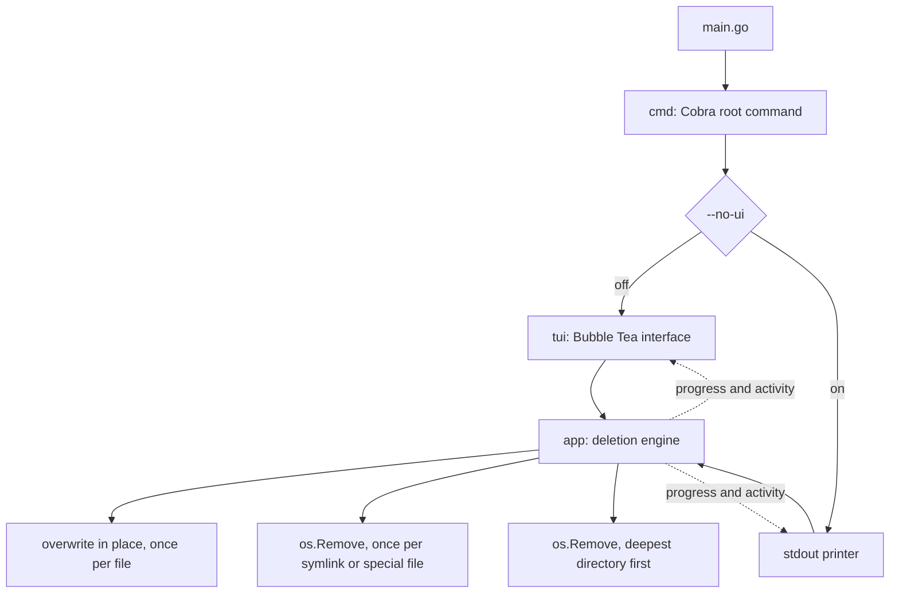

# 🧽 blank

`blank` destroys files and directories so that the contents cannot be recovered. It gives
you a Cobra command line and a Bubble Tea terminal interface that shows live progress and
an activity log.

> **Destruction is permanent. `blank` has no undo and no trash can. Read "Known
> limitations" before you point it at anything you care about.**

## How it works

`blank` expands each argument into a list of targets and sorts them by what destroying one
means. It overwrites every file concurrently, then unlinks every symlink and special file,
then removes every directory.



Each file is opened and written over in place: `--passes` random covers, 10 by default,
then one zero cover, with a flush to the device after each. The name is then replaced with
a meaningless one of the same length before the entry is unlinked, because a directory
entry carries the filename long after the contents are gone. `--jobs` sets how many files
are worked on at the same time.

Directories are removed deepest first, one at a time, and a directory that still holds
anything is reported rather than emptied. That is what stops a file whose overwrite failed
from being unlinked with its contents intact.

A symlink and a special file hold no contents of their own, so `blank` unlinks them rather
than overwriting them. A symlink is never followed, so naming one destroys the link and
leaves the file it points at alone.

## Before it starts

Expanding the arguments reads the filesystem and changes nothing, so `blank` knows the
whole list of targets before it destroys the first one. Three checks run on that list.

**It refuses a path that holds everything else.** The root of the filesystem, the
directories an operating system installs itself into, your home directory, and any
directory holding one of those. One refused argument stops the whole command line, because
the arguments beside a mistyped one are not to be trusted either.

```console
$ blk ~
Error: /home/dev is a protected path, which blank refuses to destroy
```

There is no flag to override this. The answer to a refusal is to name a narrower path,
which is also the answer to the mistake it catches.

**`--dry-run` lists every target and destroys nothing.** It reads the same plan the run
works from, in the order the run reaches each target.

```console
$ blk --dry-run ./old-project
Overwriting /home/dev/old-project/notes.txt
Removing /home/dev/old-project/link
Deleting directory /home/dev/old-project
Dry run. 1 file, 1 symlink or special file, and 1 directory. Nothing was destroyed.
```

**It asks before it destroys anything.** Only a whole `yes` goes on. Anything else stops
the run and exits non-zero, and so does a closed input, so a command in a pipeline refuses
rather than waits. Pass `--yes` from a script.

```console
$ blk ./old-project
blank will destroy 1 file, 1 symlink or special file, and 1 directory.
This cannot be undone. Type yes to continue:
```

## What happens when a target survives

`blank` exits non-zero and names every target it did not destroy, on stderr, in both
modes. A target survives when the walk cannot list a directory, when the overwrite fails,
or when a directory is still not empty by the time the run reaches it.

```console
$ blk --yes ./tree
Error: 2 targets survived the run
  /home/dev/tree/locked: read directory: open /home/dev/tree/locked: permission denied
  /home/dev/tree: remove directory: remove /home/dev/tree: directory not empty
$ echo $?
1
```

A target that survives keeps its directory. The removal refuses a directory that still
holds something, so the entry stays where the caller can find it.

How much of a survivor is left depends on where the run stopped. A file the overwrite
could not open still holds its contents. A file whose covers were written, and which then
could not be renamed or unlinked, is already zeros. `blank` reports both, because both are
targets it did not finish, and neither is a file it can promise anything about.

The status line under the progress bar reports the same verdict, so the interface and the
exit code cannot disagree.

| Status line | Exit code |
| --- | --- |
| `blanking` | The run is still going. |
| `blanking complete` | 0. Every target was destroyed. |
| `blanking failed, 2 targets survived` | 1. The error names them on stderr. |
| `blanking cancelled` | 1. Every target it did not reach is named on stderr. |

Read the exit code rather than the progress bar. The bar counts targets attempted rather
than targets destroyed, so it reaches 100% on a run that left plaintext on disk.

Only a run that destroyed every target exits 0. A cancelled run exits non-zero and names
what it stopped short of, because everything behind the stop is still on disk. A refused
question, a refused path, and a log that could not be opened all exit non-zero having
destroyed nothing.

## Requirements

| Dependency | Why |
| --- | --- |
| Go 1.24.2 or later | To build the binary. |

Nothing else. The overwrite and every removal are Go standard library calls, so `blank`
runs with an empty `PATH` and needs no coreutils. It cross compiles for Windows, which no
release has been tested on.

## Install

```sh
just install
```

This builds the binary and writes it to `~/self-made-bin/blank`. That directory is not on
`PATH` by default, so add an alias:

```sh
alias blk="$HOME/self-made-bin/blank"
```

## Usage

```sh
blk ./notes.txt ./old-project
```

Check the aim with `--dry-run` first. The run then asks before it destroys anything, and
`--yes` skips the question for a script.

The interface renders inline rather than taking over the screen, so the final frame stays
in your scrollback after the program exits. The activity panel holds the last 200 lines
and scrolls. Pass `--log <path>` when you want the full manifest of a larger run.

Each row carries one target, and the cell before the name says how far that target has
got.

| Cell | Meaning |
| --- | --- |
| `⠋` | The overwrite is running. The animation only moves while work is in flight. |
| blank | The target is destroyed. |
| `!` | The target survived. The run will exit non-zero and name it. |

A row settles the moment its own target settles, so what is left marked is what still
needs reading. The panel shows as many rows in flight as `--jobs` allows.

### Keys

| Key | Action |
| --- | --- |
| `q`, `esc`, `ctrl+c` | Cancel the run and quit |
| `k`, `up` | Scroll the activity panel up one line |
| `j`, `down` | Scroll the activity panel down one line |
| `b`, `pgup` | Scroll up half a page |
| `f`, `pgdown` | Scroll down half a page |

The panel follows the newest row until you scroll away from it. It then holds where you
left it for the rest of the run, and it follows again once you scroll back to the newest
row.

`ctrl+c` cancels the context. Files already overwritten stay destroyed.

### Flags

| Flag | Effect |
| --- | --- |
| `--dry-run` | List every target and destroy nothing. |
| `--yes`, `-y` | Destroy without asking first. |
| `--jobs` | Targets to overwrite at the same time. Default 16. Below 1 is refused. |
| `--passes` | Random covers over each file before the zero cover. Default 10. Below 0 is refused. |
| `--log <path>` | Write the run log to this path. Off by default. |
| `--no-ui` | Turn off the terminal interface and print one line per target to stdout. |

The work is disk bound, so the best `--jobs` value belongs to the device and not to the
processor count. Over 120 files of 1 MiB on an NVMe disk, 16 workers took 136ms, 8 took
143ms, 100 took 177ms, and 4 took 216ms. Measure your own disk before you change it.

The log holds one line per target and names the full path of each, so it is a manifest of
what you destroyed and where it lived. Choose a path you are willing to leave that at. It
is mode `0600`, readable only by you, whether the run creates it or appends to a file
already there. A path that is a symlink, or that cannot be opened, stops the run before it
destroys anything.

## Known limitations

These are properties of the current implementation. Each one is reproducible.

- **A target that fails before the walk queues it gets no row.** A directory the walk
  cannot list is counted in the status line and named in the error, but no row in the
  panel carries a `!` for it, because the run never reached it.
- **A hardlink is overwritten like any other file.** A hardlink is the file rather than a
  pointer to it, so destroying one destroys the contents every other link shares.
- **Writing over a file does not always reach the bytes it held.** An SSD remaps blocks as
  it writes, and a copy-on-write filesystem such as APFS, Btrfs or ZFS may place the new
  data somewhere else and leave the old blocks intact. A snapshot, a journal, or a backup
  keeps its own copy either way. This limit is the storage layer's, not the tool's, and no
  number of passes removes it. Full disk encryption is the answer that does.
- **The protected path guard resolves symlinks, but not mount points.** It reads the path
  you typed, and the same path with every symlink above the last component resolved,
  against a list and against your home directory. A bind mount of a system path inside
  your home is a second name the resolution cannot see, so it is walked like any other
  directory. The guard catches a mistyped argument, which is what it is for. It is not a
  barrier against someone determined to destroy their own machine.

## Development

```sh
just          # list every recipe
just check    # the full gate: format check, vet, staticcheck, race tests, build
just run .    # go run . with the local build cache
just e2e      # generate a dummy tree, destroy it, and check what survived
```

`just check` is the gate. Run it before every commit and read its exit code.

| Recipe | Purpose |
| --- | --- |
| `fmt`, `fmt-check` | Rewrite or report `gofmt` drift. |
| `lint` | `go vet` plus `staticcheck`. |
| `test`, `test-race` | Run the suite, with or without the race detector. |
| `build`, `build-race` | Write the binary to `bin/`. |
| `release <os> <arch>`, `release-all` | Cross compile into `dist/`. |
| `checksums` | Write `dist/SHA256SUMS`. |
| `clean` | Remove `bin/`, `dist/`, and the local build cache. |

## Layout

```text
.
├── main.go                 # Entry point. Calls cmd.Execute.
├── cmd/root.go             # Cobra root command: flags, logging, mode choice.
├── cmd/plan.go             # Prints the plan, and asks before the run starts.
├── app/blank.go            # Runs the deletion and reports what survived it.
├── app/plan.go             # Expands the arguments into what a run would destroy.
├── app/guard.go            # The paths a run refuses to destroy.
├── app/overwrite.go        # Destroys one file: the covers, the rename, the unlink.
├── tui/tui.go              # Bubble Tea model: state, sizing, layout.
├── tui/chrome.go           # The frame around the content: mark, panel, markers, palette.
├── utils/gen-dummy-df.py   # Generates a dummy tree for `just e2e`.
├── justfile                # Every task.
└── AGENTS.md               # Contributor guidelines.
```

The terminal interface follows the house terminal idiom: ANSI_Shadow block art, a `[ ]`
marker on the current row, square corners, and the Rose Pine palette. `tui/chrome.go` holds
the one border value and the one palette that every other renderer reads.
