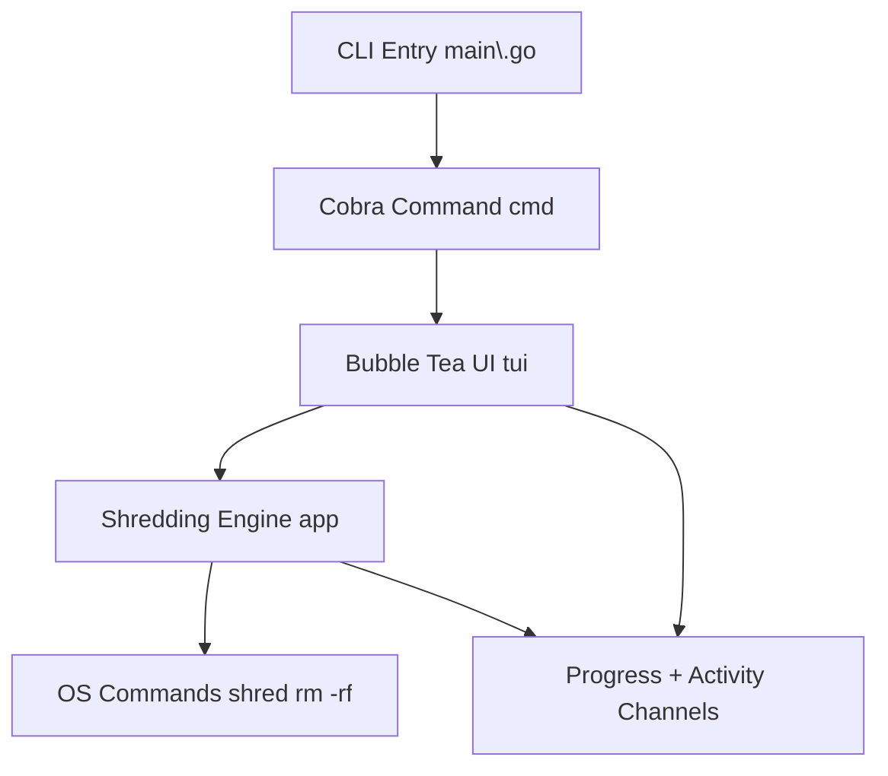

# gshred

`gshred` is a learning project that wraps the Unix `shred` utility with a modern Cobra CLI and Charmbracelet Bubble Tea interface. It expands any file or directory arguments, securely overwrites each file, removes directories, and surfaces live progress plus an activity log inside the terminal UI.

## Project Structure

```text
.
├── cmd/           # Cobra root command wiring (flags, execution)
├── app/           # Core shredding engine, walkers, and concurrency control
├── tui/           # Bubble Tea UI: progress bar + scrollable activity log
├── utils/         # Helper scripts (e.g., dummy data generators)
├── main.go        # Entry point that invokes cmd.Execute
├── justfile       # Common tasks: fmt, build, release
└── AGENTS.md      # Contributor guidelines
```

## Architecture Overview



- `cmd/root.go` validates arguments and launches the TUI.
- `tui/tui.go` renders the progress bar and a viewport showing the files currently being shredded; it also forwards quit/scroll keys.
- `app/gshred.go` walks input paths, orchestrates concurrent shredders, and writes updates to the progress/activity channels.

## Development Workflow

| Command         | Purpose                                                                 |
| --------------- | ----------------------------------------------------------------------- |
| `just fmt`      | Run `gofmt` across the project.                                         |
| `just build`    | Resolve deps, format, and produce `bin/gshred`.                         |
| `just run …`    | Wrap `go run .` (TUI) with a local `GOCACHE`; pass any files/dirs.      |
| `just test`     | Execute `go test ./...` with a writable cache path.                     |
| `just e2e`      | Generate rich test data via `utils/gen-dummy-df.py` and shred it headlessly. |

Logs are redirected to `gshred.log` during TUI runs so stdout remains clean. Binaries and artifacts are written under `bin/` or `dist/` and should stay out of version control. When extending the repo, mirror the structure above so new modules remain easy to locate.
