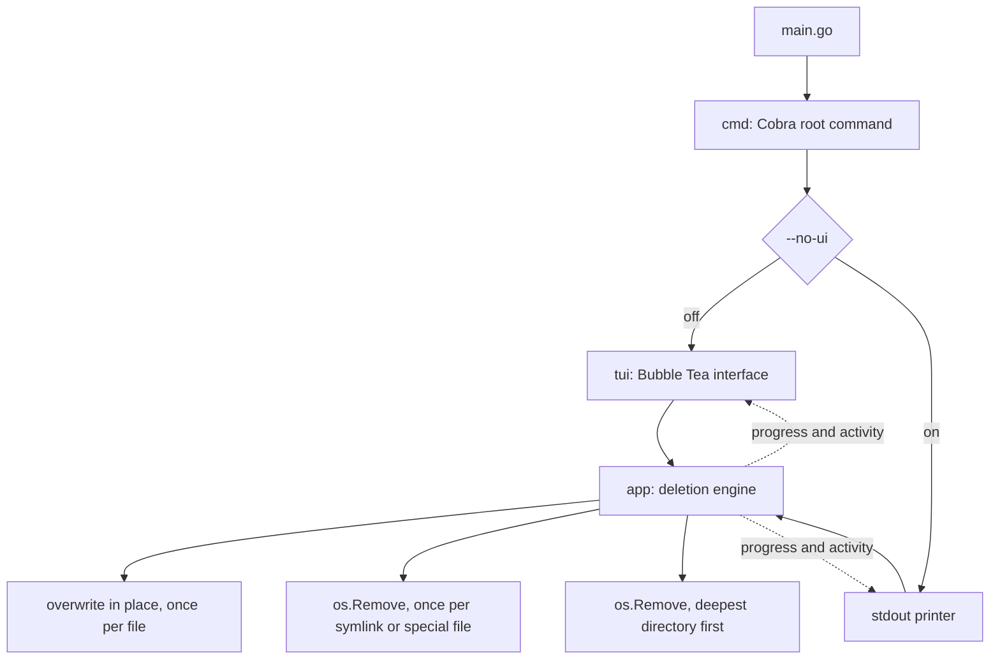

# 🧽 blank

`blank` destroys files and directories so that the contents cannot be recovered. It gives
you a Cobra command line and a Bubble Tea terminal interface that shows live progress and
an activity log.

> **Destruction is permanent. `blank` has no undo and no trash can. Read "Known
> limitations" before you point it at anything you care about.**

## How it works

`blank` expands each argument into a list of targets and sorts them by what destroying one
means. It overwrites every file concurrently, then unlinks every symlink and special file,
then removes every directory.



Each file is opened and written over in place: `--passes` random covers, 10 by default,
then one zero cover, with a flush to the device after each. The name is then replaced with
a meaningless one of the same length before the entry is unlinked, because a directory
entry carries the filename long after the contents are gone. `--jobs` sets how many files
are worked on at the same time.

Directories are removed deepest first, one at a time, and a directory that still holds
anything is reported rather than emptied. That is what stops a file whose overwrite failed
from being unlinked with its contents intact.

A symlink and a special file hold no contents of their own, so `blank` unlinks them rather
than overwriting them. A symlink is never followed, so naming one destroys the link and
leaves the file it points at alone.

## What happens when a target survives

`blank` exits non-zero and names every target it did not destroy, on stderr, in both
modes. A target survives when the walk cannot list a directory, when the overwrite fails,
or when a directory is still not empty by the time the run reaches it.

```console
$ blk ./tree
Error: 2 targets survived the run
  /home/dev/tree/locked: read directory: open /home/dev/tree/locked: permission denied
  /home/dev/tree: remove directory: remove /home/dev/tree: directory not empty
$ echo $?
1
```

A target that survives keeps its directory. The removal refuses a directory that still
holds something, so the file stays where the caller can find it.

The status line under the progress bar reports the same verdict, so the interface and the
exit code cannot disagree.

| Status line | Exit code |
| --- | --- |
| `blanking` | The run is still going. |
| `blanking complete` | 0. Every target was destroyed. |
| `blanking failed, 2 targets survived` | 1. The error names them on stderr. |
| `blanking cancelled` | The run stopped before it finished. |

Read the exit code rather than the progress bar. The bar counts targets attempted rather
than targets destroyed, so it reaches 100% on a run that left plaintext on disk.

## Requirements

| Dependency | Why |
| --- | --- |
| Go 1.24.2 or later | To build the binary. |

Nothing else. The overwrite and every removal are Go standard library calls, so `blank`
runs with an empty `PATH` and needs no coreutils. It cross compiles for Windows, which no
release has been tested on.

## Install

```sh
just install
```

This builds the binary and writes it to `~/self-made-bin/blank`. That directory is not on
`PATH` by default, so add an alias:

```sh
alias blk="$HOME/self-made-bin/blank"
```

## Usage

```sh
blk ./notes.txt ./old-project
```

The interface renders inline rather than taking over the screen, so the final frame stays
in your scrollback after the program exits. The activity panel holds the last 200 lines
and scrolls. Pass `--log` when you want the full manifest of a larger run.

Each row carries one target, and the cell before the name says how far that target has
got.

| Cell | Meaning |
| --- | --- |
| `⠋` | The overwrite is running. The animation only moves while work is in flight. |
| blank | The target is destroyed. |
| `!` | The target survived. The run will exit non-zero and name it. |

A row settles the moment its own target settles, so what is left marked is what still
needs reading. The panel shows as many rows in flight as `--jobs` allows.

### Keys

| Key | Action |
| --- | --- |
| `q`, `esc`, `ctrl+c` | Cancel the run and quit |
| `k`, `up` | Scroll the activity panel up one line |
| `j`, `down` | Scroll the activity panel down one line |
| `b`, `pgup` | Scroll up half a page |
| `f`, `pgdown` | Scroll down half a page |

`ctrl+c` cancels the context. Files already overwritten stay destroyed.

### Flags

| Flag | Effect |
| --- | --- |
| `--jobs` | Targets to overwrite at the same time. Default 16. Below 1 is refused. |
| `--passes` | Random covers over each file before the zero cover. Default 10. Below 0 is refused. |
| `--log` | Write logs to `blank.log` in the working directory. Off by default. |
| `--no-ui` | Hidden. Turn off the terminal interface and print progress to stdout. |

The work is disk bound, so the best `--jobs` value belongs to the device and not to the
processor count. Over 120 files of 1 MiB on an NVMe disk, 16 workers took 136ms, 8 took
143ms, 100 took 177ms, and 4 took 216ms. Measure your own disk before you change it.

`blank.log` records the full path of every file the run touched, so treat it as a manifest
of what you destroyed. It is created mode `0600`, readable only by you.

## Known limitations

These are properties of the current implementation. Each one is reproducible.

- **Scrolling does not hold during a run.** Every new target jumps the panel back to the
  newest row, so `k` and `j` only stay put once the run has finished.
- **A target that fails before the walk queues it gets no row.** A directory the walk
  cannot list is counted in the status line and named in the error, but no row in the
  panel carries a `!` for it, because the run never reached it.
- **A hardlink is overwritten like any other file.** A hardlink is the file rather than a
  pointer to it, so destroying one destroys the contents every other link shares.
- **Writing over a file does not always reach the bytes it held.** An SSD remaps blocks as
  it writes, and a copy-on-write filesystem such as APFS, Btrfs or ZFS may place the new
  data somewhere else and leave the old blocks intact. A snapshot, a journal, or a backup
  keeps its own copy either way. This limit is the storage layer's, not the tool's, and no
  number of passes removes it. Full disk encryption is the answer that does.
- **There is no confirmation prompt and no dry run.** The program starts destroying as
  soon as it parses the arguments, and it refuses no path.

## Development

```sh
just          # list every recipe
just check    # the full gate: format check, vet, staticcheck, race tests, build
just run .    # go run . with the local build cache
just e2e      # generate a dummy tree and delete it headlessly
```

`just check` is the gate. Run it before every commit and read its exit code.

| Recipe | Purpose |
| --- | --- |
| `fmt`, `fmt-check` | Rewrite or report `gofmt` drift. |
| `lint` | `go vet` plus `staticcheck`. |
| `test`, `test-race` | Run the suite, with or without the race detector. |
| `build`, `build-race` | Write the binary to `bin/`. |
| `release <os> <arch>`, `release-all` | Cross compile into `dist/`. |
| `checksums` | Write `dist/SHA256SUMS`. |
| `clean` | Remove `bin/`, `dist/`, and the local build cache. |

## Layout

```text
.
├── main.go                 # Entry point. Calls cmd.Execute.
├── cmd/root.go             # Cobra root command: flags, logging, mode choice.
├── app/blank.go            # Walks the arguments and runs the deletion.
├── app/overwrite.go        # Destroys one file: the covers, the rename, the unlink.
├── tui/tui.go              # Bubble Tea model: state, sizing, layout.
├── tui/chrome.go           # The frame around the content: mark, panel, markers, palette.
├── utils/gen-dummy-df.py   # Generates a dummy tree for `just e2e`.
├── justfile                # Every task.
└── AGENTS.md               # Contributor guidelines.
```

The terminal interface follows the house terminal idiom: ANSI_Shadow block art, a `[ ]`
marker on the current row, square corners, and the Rose Pine palette. `tui/chrome.go` holds
the one border value and the one palette that every other renderer reads.
