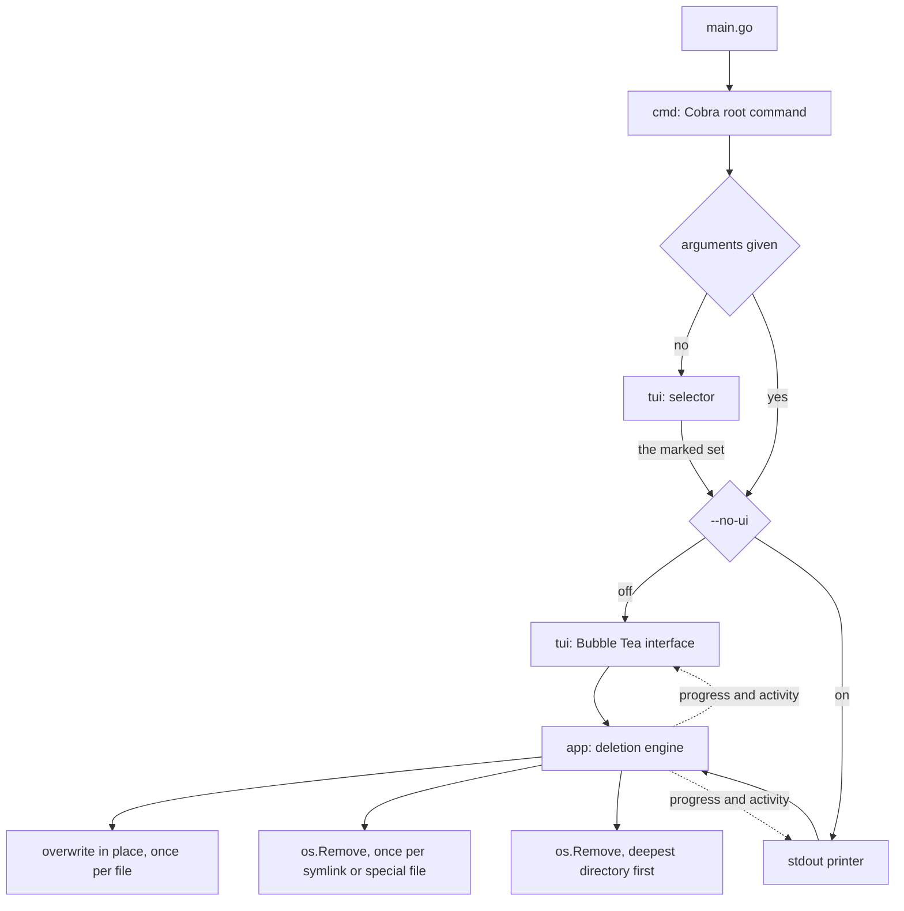

# 🧽 blank

`blank` destroys files and directories so that the contents cannot be recovered. It gives
you a Cobra command line and a Bubble Tea terminal interface that shows live progress and
an activity log.

> **Destruction is permanent. `blank` has no undo and no trash can. Read "Known
> limitations" before you point it at anything you care about.**

## How it works

`blank` expands each argument into a list of targets and sorts them by what destroying one
means. It overwrites every file concurrently, then unlinks every symlink and special file,
then removes every directory.



Each file is opened and written over in place: `--passes` random covers, 10 by default,
then one zero cover, with a flush to the device after each. The name is then replaced with
a meaningless one of the same length before the entry is unlinked, because a directory
entry carries the filename long after the contents are gone. `--jobs` sets how many files
are worked on at the same time.

Directories are removed deepest first, one at a time, and a directory that still holds
anything is reported rather than emptied. That is what stops a file whose overwrite failed
from being unlinked with its contents intact.

A symlink and a special file hold no contents of their own, so `blank` unlinks them rather
than overwriting them. A symlink is never followed, so naming one destroys the link and
leaves the file it points at alone.

## Before it starts

Expanding the arguments reads the filesystem and changes nothing, so `blank` knows the
whole list of targets before it destroys the first one. Three checks run on that list.

**It refuses a path that holds everything else.** The root of the filesystem, the
directories an operating system installs itself into, your home directory, and any
directory holding one of those. One refused argument stops the whole command line, because
the arguments beside a mistyped one are not to be trusted either.

```console
$ blk ~
Error: /home/dev is a protected path, which blank refuses to destroy
```

There is no flag to override this. The answer to a refusal is to name a narrower path,
which is also the answer to the mistake it catches.

**`--dry-run` lists every target and destroys nothing.** It reads the same plan the run
works from, in the order the run reaches each target.

```console
$ blk --dry-run ./old-project
Overwriting /home/dev/old-project/notes.txt
Removing /home/dev/old-project/link
Deleting directory /home/dev/old-project
Dry run. 1 file, 1 symlink or special file, and 1 directory. Nothing was destroyed.
```

**It asks before it destroys anything.** Only a whole `yes` goes on. Anything else stops
the run and exits non-zero, and so does a closed input, so a command in a pipeline refuses
rather than waits. Pass `--yes` from a script.

```console
$ blk ./old-project
blank will destroy 1 file, 1 symlink or special file, and 1 directory.
Selected roots:
  /home/dev/old-project
This cannot be undone. Type yes to continue:
```

## What happens when a target is not destroyed

`blank` exits non-zero and names every target it did not destroy, on stderr, in both
modes. A target is left behind when the walk cannot list a directory, when the overwrite
fails, or when a directory is still not empty by the time the run reaches it.

Each name carries the state the target was left in, because the two are opposites and the
name alone cannot tell them apart:

| State | What is on the disk |
| --- | --- |
| `intact` | The target still holds everything it held. Its mode may have been widened to `0600`, because an overwrite forces the mode once when the first open is refused. |
| `damaged, the contents are gone` | The entry is still there and its contents are not. At least one cover landed, so what it held is unrecoverable. |

```console
$ blk --yes ./tree
Error: 2 targets were not destroyed
  /home/dev/tree/locked: read directory: open /home/dev/tree/locked: permission denied (intact)
  /home/dev/tree/notes.txt: rename: permission denied (damaged, the contents are gone)
$ echo $?
1
```

A target that is left behind keeps its directory. The removal refuses a directory that
still holds something, so the entry stays where the caller can find it.

A cancelled run over a large file is the usual way to reach the damaged state. The covers
are written a megabyte at a time, so a stop lands in the middle of one, and every file in
flight at that moment is damaged. `--jobs` files are in flight at once.

The status line under the progress bar reports the same verdict, so the interface and the
exit code cannot disagree.

| Status line | Exit code |
| --- | --- |
| `blanking` | The run is still going. |
| `blanking complete` | 0. Every target was destroyed. |
| `blanking failed, 2 targets survived` | 1. The error names them, and their state, on stderr. |
| `blanking cancelled` | 1. Every target it did not destroy is named on stderr. |

Regular files are weighted by the bytes written across every random and zero cover, plus
one unit for the removal that ends them, so a large file moves the bar while it is being
overwritten. Removals and directories receive one unit each. Only work that finished counts,
and the removal unit is earned by the unlink rather than by the covers, so the bar reaches
100% when every target was destroyed and never when one was left on the disk.

Only a run that destroyed every target exits 0. A cancelled run exits non-zero and names
what it stopped short of. Read that list rather than assuming a stop left everything alone,
because a target the covers had already reached is named `damaged` and its contents are
gone. A refused question, a refused path, a selector left with nothing marked, and a log
that could not be opened all exit non-zero having destroyed nothing.

## Requirements

| Dependency | Why |
| --- | --- |
| Go 1.27 or later | To build the binary. Not needed to install a release. |

Nothing else. The overwrite and every removal are Go standard library calls, so `blank`
runs with an empty `PATH` and needs no coreutils. It cross compiles for Windows, which no
release has been tested on.

## Install

Homebrew, on macOS. Homebrew serves `blank` as a cask, and a cask does not install on
Linux:

```sh
brew install --cask GF6599/tap/blank
```

With a Go toolchain, on either platform:

```sh
go install github.com/GF6599/blank@latest
```

A release also carries a `tar.gz` for darwin and linux on amd64 and arm64, with
`checksums.txt` beside it.

`just install` writes the binary to `~/self-made-bin/blank` instead. That directory is not
on `PATH` by default, so add an alias:

```sh
alias blk="$HOME/self-made-bin/blank"
```

`blank --version` names the build, which is what a bug report needs.

## Usage

```sh
blk ./notes.txt ./old-project
```

Check the aim with `--dry-run` first. The run then asks before it destroys anything, and
`--yes` skips the question for a script.

### Choosing targets without naming them

Run `blk` with no arguments and it opens a selector on the working directory. Mark what you
want, press `enter`, and the marked set becomes the arguments. Everything after that is the
same: the same guard, the same plan, and the same question before anything is destroyed.

```console
$ blk
  1/22  2 marked                          [space] mark  [enter] done  [q] quit

  ┌─ /home/dev/old-project ──────────────────────────────────────────────────┐
  │[ * notes.txt                                                            ]│
  │    archive/                                                              │
  │  * keys/                                                                 │
  │  - Library/                                                              │
  └──────────────────────────────────────────────────────────────────────────┘
```

| Cell | Meaning |
| --- | --- |
| `*` | Marked. The run will destroy this. |
| `-` | Refused. This is a protected path, so no key marks it. |
| blank | Not marked. |

A name ending in `/` is a directory, and marking one destroys everything under it. A name
ending in `@` is a symlink, and marking one destroys the link and never what it points at.

| Key | Action |
| --- | --- |
| `space` | Mark or unmark the entry under the cursor |
| `l`, `right` | Go into the directory under the cursor |
| `h`, `left`, `backspace` | Go up one directory, and stop at a protected one |
| `j`, `k`, `up`, `down` | Move the cursor |
| `/` | Filter this directory by name |
| `enter` | Done. Hand the marked set to the run |
| `q`, `ctrl+c` | Quit. Destroy nothing |
| `esc` | Clear the filter, or quit when there is none |

A mark holds while you browse, so targets in several directories go to one run. The count
beside the position says how many are marked, and a filter reports how much of the
directory it is hiding.

**The selector never lists a protected directory.** It refuses to open in one, and the up
key stops at the first one above you. Marking a row costs one keystroke, and the command
line costs a typed path, so the selector holds to the stricter rule.

```console
$ cd ~ && blk
Error: /home/dev is a protected path, which blank refuses to destroy, so it will not open
a selector there either. Name a path on the command line, or change to a narrower
directory first.
```

Going down never needs a check. A directory that holds a protected path is refused itself,
so nothing the selector is allowed to list has one inside it.

The selector needs a terminal. With `--no-ui`, or with anything other than a terminal on
standard input, `blk` with no arguments prints the usage instead, so a script never waits
on a screen nobody can answer.

The interface renders inline rather than taking over the screen, so the final frame stays
in your scrollback after the program exits. The activity panel holds the last 200 lines
and scrolls. Pass `--log <path>` when you want the full manifest of a larger run.

Each row carries one target, and the cell before the name says how far that target has
got.

| Cell | Meaning |
| --- | --- |
| `⠋` | The overwrite is running. The animation only moves while work is in flight. |
| blank | The target is destroyed. |
| `!` | The target survived. The run will exit non-zero and name it. |

A row settles the moment its own target settles, so what is left marked is what still
needs reading. The panel shows as many rows in flight as `--jobs` allows.

### Keys

| Key | Action |
| --- | --- |
| `q`, `ctrl+c` | Cancel the run and quit |
| `esc` | Clear the filter, or cancel the run when there is none |
| `/` | Filter the activity panel by name |
| `k`, `up` | Scroll the activity panel up one line |
| `j`, `down` | Scroll the activity panel down one line |
| `b`, `pgup` | Scroll up half a page |
| `f`, `pgdown` | Scroll down half a page |

The panel follows the newest row until you scroll away from it. It then holds where you
left it for the rest of the run, and it follows again once you scroll back to the newest
row.

The filter narrows what the panel draws and never what the run does. Rows still settle
behind it, and the status line still counts every target that survived, so the verdict is
the same whether you are filtering or not. The panel title carries the filter and both
counts, because a filtered panel otherwise reads as a short run.

`ctrl+c` cancels the context, whether or not the filter is open. Files already overwritten
stay destroyed.

### Flags

| Flag | Effect |
| --- | --- |
| `--dry-run` | List every target and destroy nothing. |
| `--yes`, `-y` | Destroy without asking first. |
| `--jobs` | Targets to overwrite at the same time. Default 16. Below 1 is refused. |
| `--passes` | Random covers over each file before the zero cover. Default 10. Below 0 is refused. |
| `--log <path>` | Write the run log outside the selected targets. Off by default. |
| `--no-ui` | Turn off the terminal interface and print one line per target to stdout. |
| `--version` | Print the version, the commit, and the build date. |

The work is disk bound, so the best `--jobs` value belongs to the device and not to the
processor count. Over 120 files of 1 MiB on an NVMe disk, 16 workers took 136ms, 8 took
143ms, 100 took 177ms, and 4 took 216ms. The default suits many small files. A few large
ones stop improving sooner: over 4 files of 256 MiB on the same disk, 4 workers took 0.60s,
16 took 0.70s, and 1 took 1.22s. Memory does not follow the file size, because each worker
holds one 1 MiB buffer, so the whole run stays near 17 MB whatever it is destroying.
Measure your own disk before you change it.

The log holds one line per target and names the full path of each, so it is a manifest of
what you destroyed and where it lived. Choose a path you are willing to leave that at. It
is mode `0600`, readable only by you, whether the run creates it or appends to a file
already there. A path that is a symlink, or that cannot be opened, stops the run before it
destroys anything. A path inside any selected target is refused, because the run would
otherwise destroy its own manifest. A dry run never creates or opens the log.

## Known limitations

These are properties of the current implementation. Each one is reproducible.

- **A target that fails before the walk queues it gets no row.** A directory the walk
  cannot list is counted in the status line and named in the error, but no row in the
  panel carries a `!` for it, because the run never reached it.
- **A hardlink is overwritten like any other file.** A hardlink is the file rather than a
  pointer to it, so destroying one destroys the contents every other link shares.
- **Writing over a file does not always reach the bytes it held.** An SSD remaps blocks as
  it writes, and a copy-on-write filesystem such as APFS, Btrfs or ZFS may place the new
  data somewhere else and leave the old blocks intact. A snapshot, a journal, or a backup
  keeps its own copy either way. This limit is the storage layer's, not the tool's, and no
  number of passes removes it. Full disk encryption is the answer that does.
- **The selector does not go into a symlink.** The engine unlinks a symlink and never reads
  through one, so the selector reads it the same way and the arrow key does nothing on one.
  Name the path on the command line to reach what is behind it. Where you start is the one
  exception: a working directory reached through a symlink is resolved before it is
  checked, because the selector lists what it points at.
- **The selector is confined to the tree below the nearest protected directory.** From
  `~/projects` you can browse anything under it, and you cannot go up into your home
  directory. Name a path on the command line to reach anything higher.
- **The selector reads a large directory in one go.** A directory of 10,000 entries took
  117ms to list on an NVMe disk, because every entry is checked against the protected paths
  as it is read. The read runs as a Bubble Tea command, so the interface renders a loading
  state and quit remains responsive while it finishes.
- **A name is escaped, but a lookalike letter is not caught.** Every control character,
  every default ignorable code point, every format character, and the line and paragraph
  separators display as their code points, read from the Unicode data, so an invisible or
  reordering character cannot make one name pass for another. An emoji with a variation
  selector therefore shows the selector as `\u{fe0f}`. A letter from another script that
  looks like a Latin one, such as the Cyrillic `а`, displays as itself.
- **The protected path guard resolves symlinks, but not mount points.** It reads the path
  you typed, and the same path with every symlink above the last component resolved,
  against a list and against your home directory. A bind mount of a system path inside
  your home is a second name the resolution cannot see, so it is walked like any other
  directory. The guard catches a mistyped argument, which is what it is for. It is not a
  barrier against someone determined to destroy their own machine.

## Development

```sh
just          # list every recipe
just check    # the full gate: format check, vet, staticcheck, govulncheck, race tests, build
just run .    # go run . with the local build cache
just e2e      # generate a dummy tree, destroy it, and check what survived
```

`just check` is the gate. Run it before every commit and read its exit code.

| Recipe | Purpose |
| --- | --- |
| `fmt`, `fmt-check` | Rewrite or report `gofmt` drift. |
| `lint` | `go vet`, `staticcheck`, and `govulncheck`. |
| `test`, `test-race` | Run the suite, with or without the race detector. |
| `build`, `build-race` | Write the binary to `bin/`. |
| `release-dry-run` | Render a full release into `dist/` and publish none of it. |
| `clean` | Remove `bin/`, `dist/`, and the local build cache. |

Each linter is pinned by a tool directive in `go.mod` and run through `go tool`, so a laptop
and CI resolve it against the same dependency graph and report the same findings.

### Releasing

A release is a semver tag. Pushing one runs the gate, then goreleaser builds the archives,
writes the checksums, publishes the GitHub release, and updates the Homebrew cask in
`GF6599/homebrew-tap`.

```sh
git tag v0.1.0 && git push origin v0.1.0
```

Run the Release workflow by hand to render everything a tag would publish and publish none
of it. That is where a template error surfaces, so prove an upgrade there before tagging.

## Layout

```text
.
├── main.go                 # Entry point. Calls cmd.Execute.
├── cmd/root.go             # Cobra root command: flags, logging, mode choice.
├── cmd/plan.go             # Prints the plan, and asks before the run starts.
├── app/blank.go            # Runs the deletion and reports what survived it.
├── app/plan.go             # Expands the arguments into what a run would destroy.
├── app/guard.go            # The paths a run refuses to destroy.
├── app/overwrite.go        # Destroys one file: the covers, the rename, the unlink.
├── tui/tui.go              # Bubble Tea model: state, sizing, layout.
├── tui/picker.go           # The selector a run with no arguments opens.
├── tui/chrome.go           # The frame around the content: mark, panel, markers, palette.
├── version.go              # Resolves what --version reports for each install route.
├── utils/gen-dummy-df.py   # Generates a dummy tree for `just e2e`.
└── justfile                # Every task.
```

The terminal interface follows the house terminal idiom: ANSI_Shadow block art, a `[ ]`
marker on the current row, square corners, and the Rose Pine palette. `tui/chrome.go` holds
the one border value and the one palette that every other renderer reads.
